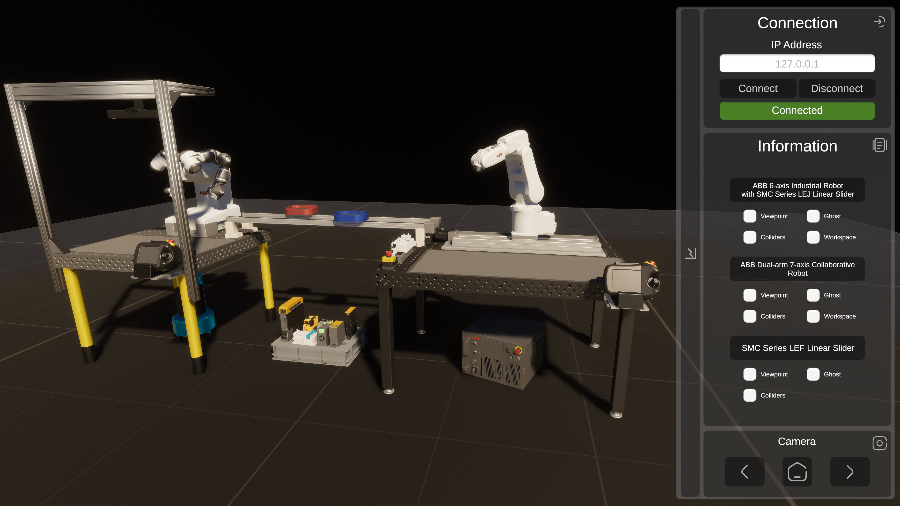
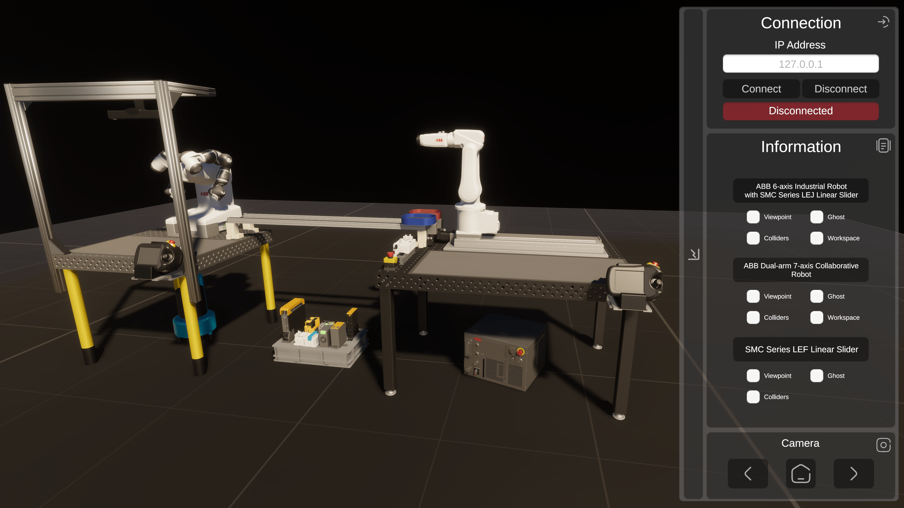
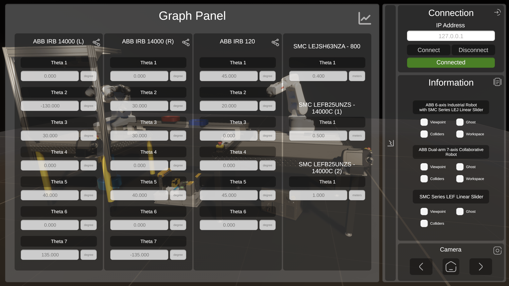

# VInRoS: Unity3D Digital Twin

<p align="center">
  <a href="LICENSE"></a>
  
  
  
  
  <a href="https://www.youtube.com/watch?v=7On3BkXgfiw"></a>
</p>

<p align="center">
  
</p>

This repository contains the **Unity3D digital twin** of the [Versatile Intelligent Robotic Workstation (VInRoS)](https://github.com/rparak/VInRoS_Overview). The application connects to the B&R PLC ([VInRoS_BaR_AS](https://github.com/rparak/VInRoS_BaR_AS)) as an **OPC UA client** and serves as a virtual plant for the cell. It receives the same commands and trajectories as the real hardware, simulates the motion of every robot and linear axis, and reports status back to the PLC. This lets you develop, test and commission the control logic without the physical workstation.

> Part of the VInRoS project. See **[VInRoS_Overview](https://github.com/rparak/VInRoS_Overview)** for the full system.

---

## Table of Contents

- [Features](#features)
- [Requirements](#requirements)
- [How It Works](#how-it-works)
- [Simulated Mechanisms](#simulated-mechanisms)
- [User Interface](#user-interface)
- [Project Structure](#project-structure)
- [Getting Started](#getting-started)
- [Related Repositories](#related-repositories)
- [Demo Video](#demo-video)
- [Citation](#citation)
- [License](#license)
- [Contact](#contact)

---

## Features

- **Complete virtual cell.** Accurate 3D models of the ABB IRB 14000, ABB IRB 120, the SMC LEJ and LEF linear axes, the tables, the electrical switchboard and the IRC5 controller.
- **OPC UA communication.** Built on the official OPC Foundation .NET Standard stack, running in a background thread with a fixed cycle time.
- **Virtual commissioning.** The twin runs the same PLC program as the real cell (`SIMULATION_ENABLE = TRUE`).
- **Smooth joint motion.** Each revolute and prismatic joint follows its target with critically damped smoothing and reports *In Position* within a tolerance.
- **Ghost visualisation.** A translucent "ghost" of each mechanism shows its target pose next to its actual pose.
- **Debug overlays.** Colliders, workspace envelopes and end-effector viewpoints can be toggled for each mechanism.
- **Live graphs.** Every joint value is displayed in real time.
- **Cross-platform.** Builds for Universal Windows Platform, Android and Linux.

## Requirements

**Software**

```text
Unity3D 2022.3.2f1 (LTS), B&R Automation Studio, Visual Studio 2019/2022
```

**Supported platforms**

```text
Universal Windows Platform, Android, Linux
```

| Software / Package | Link |
| --- | --- |
| Unity3D | https://unity3d.com/get-unity/download/archive |
| B&R Automation Studio | https://www.br-automation.com/en/downloads/#categories=Software-1344987434933 |
| Visual Studio | https://visualstudio.microsoft.com/downloads/ |
| NuGetForUnity | https://github.com/GlitchEnzo/NuGetForUnity |
| OPCFoundation.NetStandard.Opc.Ua | https://www.nuget.org/packages/OPCFoundation.NetStandard.Opc.Ua/ |

## How It Works

```text
┌────────────────────────────┐        OPC UA (opc.tcp://<PLC-IP>:4840)        ┌───────────────────────────┐
│  B&R Automation PC 2100    │  ── Command (Start/Stop/Home), Trajectories ─▶ │   Unity3D Digital Twin     │
│  VInRoS_BaR_AS             │                                                │   OPC_UA_Client.cs         │
│  SIMULATION_ENABLE = TRUE  │  ◀── Info (Active, Move_Active, In_Position),  │   + mechanism controllers  │
│                            │      actual positions                          │                           │
└────────────────────────────┘                                                └───────────────────────────┘
```

1. The client connects to the PLC's OPC UA server (namespace `ns=6`, port `4840`).
2. It reads `::AsGlobalPV:SIMULATION_ENABLE`. The twin is driven only while this flag is `TRUE`.
3. Each cycle, it reads the `Start` / `Stop` / `Home` commands from `Global_VInRoS_Str` and the trajectories from each task (`::T_ROB_1:Trajectory_Str`, `::T_MECH_1:Trajectory_Str`, ...).
4. The mechanism controllers move the virtual joints through the trajectory targets.
5. The client writes the simulated status and actual positions back, so the PLC state machines and the mappView HMI behave exactly as they do with real hardware.

Example node IDs:

```text
ns=6;s=::AsGlobalPV:SIMULATION_ENABLE
ns=6;s=::AsGlobalPV:Global_VInRoS_Str.Rob_Id_1.Command.Start
ns=6;s=::AsGlobalPV:Global_VInRoS_Str.Mech_Id_3.Position
ns=6;s=::T_ROB_1:Trajectory_Str.Targets.Joint[i].Q
```

## Simulated Mechanisms

| ID | Mechanism | Joints | Scripts |
| --- | --- | --- | --- |
| Rob 1 | ABB IRB 120 (6-axis industrial robot) | 6 × revolute | `Robot_ID_1/` |
| Rob 2 L | ABB IRB 14000, left arm | 7 × revolute | `Robot_ID_2_L/` |
| Rob 2 R | ABB IRB 14000, right arm | 7 × revolute | `Robot_ID_2_R/` |
| Mech 1, 2 | SMC LEFB25UNZS-14000C linear axes | 1 × prismatic each | `Mechanism_ID_1_2/` |
| Mech 3 | SMC LEJSH63NZA-800 linear axis (IRB 120 track) | 1 × prismatic | `Mechanism_ID_3/` |

Each mechanism has a main script that holds its state and trajectory logic, a joint controller that drives the actual pose, and a `*_Ghost` controller that drives the target pose.

## User Interface

| Panel | Function |
| --- | --- |
| **Connection** | Enter the PLC IP address, connect or disconnect, and see live connection status |
| **Information** | Toggle *Viewpoint*, *Ghost*, *Colliders* and *Workspace* for each mechanism |
| **Graph** | Live joint values: θ₁…θ₇ for each IRB 14000 arm, θ₁…θ₆ for the IRB 120, and positions of the SMC axes |
| **Camera** | Cycle through preset viewpoints or return to the home view |

<p align="center">
  
</p>

<p align="center">
  
</p>

## Project Structure

```text
VInRoS_Unity3D_Simulation/
├── images/
└── VInRoS_App/                       # Unity project (2022.3.2f1)
    ├── Assets/
    │   ├── VInRoS.unity              # Main scene
    │   ├── Script/
    │   │   ├── OPC_UA_Client.cs      # OPC UA client (threaded read/write)
    │   │   ├── User_Interface.cs     # UI panels and visual toggles
    │   │   ├── Robot_ID_1/           # ABB IRB 120
    │   │   ├── Robot_ID_2_L/         # ABB IRB 14000, left arm
    │   │   ├── Robot_ID_2_R/         # ABB IRB 14000, right arm
    │   │   ├── Mechanism_ID_1_2/     # SMC LEFB25 linear axes
    │   │   └── Mechanism_ID_3/       # SMC LEJSH63 linear axis
    │   ├── Objects/                  # FBX models of robots, axes and cell
    │   ├── Material/  UI/  Images/
    │   ├── NuGet.config, packages.config
    │   └── Packages/                 # NuGet packages (OPC UA stack)
    ├── Packages/
    └── ProjectSettings/
```

## Getting Started

1. Clone the repository:

   ```bash
   git clone https://github.com/rparak/VInRoS_Unity3D_Simulation.git
   ```

2. Open `VInRoS_App` in **Unity Hub** with editor version **2022.3.2f1**.
3. If the OPC UA package is missing, install **OPCFoundation.NetStandard.Opc.Ua** through **NuGet → Manage NuGet Packages** ([NuGetForUnity](https://github.com/GlitchEnzo/NuGetForUnity)).
4. Prepare the PLC side: open [VInRoS_BaR_AS](https://github.com/rparak/VInRoS_BaR_AS), set `SIMULATION_ENABLE := TRUE`, then build and transfer to the Automation PC (or run it in ARsim).
5. Open the `VInRoS` scene and press **Play**.
6. In the **Connection** panel, enter the PLC's IP address (`127.0.0.1` for a local ARsim) and click **Connect**.
7. Send commands from the mappView HMI. The virtual cell moves as the real one would.

**Build:** use **File → Build Settings** and choose *Universal Windows Platform*, *Android* or *Linux*.

## Related Repositories

| Repository | Description |
| --- | --- |
| [VInRoS_Overview](https://github.com/rparak/VInRoS_Overview) | Project overview and documentation |
| [VInRoS_BaR_AS](https://github.com/rparak/VInRoS_BaR_AS) | PLC, motion, safety and HMI |
| [VInRoS_ABB_RS](https://github.com/rparak/VInRoS_ABB_RS) | ABB RobotStudio programs and simulation |
| **[VInRoS_Unity3D_Simulation](https://github.com/rparak/VInRoS_Unity3D_Simulation)** | Unity3D digital twin (this repository) |

## Demo Video

<p align="center">
  <a href="https://www.youtube.com/watch?v=7On3BkXgfiw">
    
  </a>
</p>

## Citation

```bibtex
@misc{RomanParak_VInRoS,
  author       = {Roman Parak},
  title        = {Versatile Intelligent Robotic Workstation (VInRoS)},
  year         = {2024},
  publisher    = {GitHub},
  journal      = {GitHub repository},
  howpublished = {\url{https://github.com/rparak/VInRoS_Overview}}
}
```

## License

This project is licensed under the [MIT License](LICENSE). © 2024 Roman Parak.

## Contact

**Roman Parak**: [Roman.Parak@outlook.com](mailto:Roman.Parak@outlook.com)
